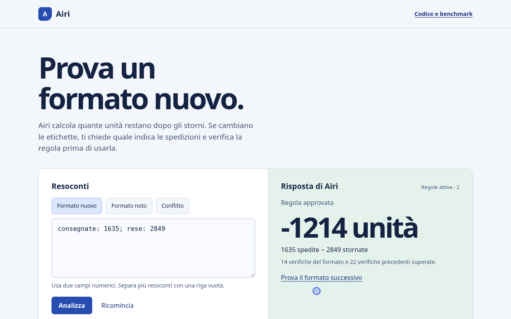

# Airi per i resoconti di magazzino

Airi legge quante unità sono state spedite e quante sono state stornate, poi calcola il saldo. Se un fornitore cambia i nomi dei due campi, Airi chiede quale dei due indica le spedizioni. Usa la risposta per provare una nuova regola su esempi verificati e la adotta se supera i controlli. Se due resoconti si contraddicono, chiede di rivederli.

## Prova nel browser

[Apri la demo pubblica di Airi](https://airi-riconciliazione.arancione3000.chatgpt.site/)

La demo esegue il motore Python nel browser. Al primo avvio carica il motore da Internet. Non serve un account o un’installazione. Premi **Analizza**, scegli **consegnate**, poi premi **Verifica e approva**. Il saldo è **−1214**. Prova poi **Conflitto** per vedere perché Airi si ferma, oppure modifica il testo con quantità inventate.

I resoconti restano nel browser e il registro della demo si azzera al ricaricamento della pagina. Per l’approvazione la demo usa i casi di verifica già preparati per gli esempi inclusi.

Per usare il calcolo in un altro programma, puoi inviare le quantità o il testo del resoconto all’API gratuita. [Istruzioni e chiamata di esempio](api/README.md)

## Guarda la demo registrata

La registrazione di 25 secondi mostra la scelta sbagliata, il controllo delle due nuove regole e un conflitto su cui Airi si ferma. La prova usa esempi sintetici ed è senza audio. [Scarica il video MP4](https://github.com/arancione3000/airi-offline-training/releases/download/airi-riconciliazione-demo-v0.1.0/airi-demo.mp4)



[Domanda sul formato](media/01-domanda.png) · [Regola approvata](media/02-approvazione.png) · [Conflitto da rivedere](media/03-conflitto.png)

## Risultati e limiti

Nella prova sintetica su 54 casi nuovi, Airi e uno script Python aggiornato a mano hanno ottenuto tutti i 40 saldi attesi e si sono fermati nei 14 casi da rivedere. Airi ha ricavato le regole da una conferma per formato, con le stesse verifiche richieste allo script. Il tempo risparmiato da chi lavora con documenti reali resta da misurare. [Corpus, benchmark e riproduzione](BENCHMARK.md) · [Confronto con Qwen](QWEN.md)

## Invia una segnalazione

Per segnalare un errore o un passaggio poco chiaro, includi questi dettagli.

- Il resoconto di esempio e i passaggi che hai seguito.
- Il risultato atteso e quello mostrato dalla demo.
- Il browser e il dispositivo, se il problema riguarda l’interfaccia.

Sostituisci nomi e quantità aziendali con dati inventati prima di pubblicare l’esempio. [Apri una segnalazione su GitHub](https://github.com/arancione3000/airi-offline-training/issues/new)

## Formato dei resoconti

Airi parte dai campi `spedite` e `stornate`. L’input accetta `:` o `=` dopo il nome del campo, un punto e virgola o una nuova riga fra i due campi e interi da 0 a 1.000.000. Maiuscole, spazi e ordine dei campi possono variare. Se più resoconti riguardano lo stesso saldo, ogni fonte deve essere leggibile e tutte devono concordare **su entrambe le quantità**. Dati mancanti, resoconti incompatibili o fonti ancora sconosciute mescolate ad altre mandano la richiesta a revisione.

## Prova da terminale

Dalla radice del repository con Python 3.10 o successivo. I comandi preparano un esempio da un corpus sintetico e usano un registro nuovo.

```sh
D=scripts/research-training/adaptive-format-repair
W=$(mktemp -d)
python - "$D/CASES.json" "$W" <<'PY'
import json
from pathlib import Path
import sys

corpus = json.loads(Path(sys.argv[1]).read_text())
target = Path(sys.argv[2])
first = corpus["updates"][0]
data = {
    "reports": first["arrival"]["reports"],
    "qualification": first["qualification"],
    "protected": corpus["protected"],
}
for name, rows in data.items():
    if name != "reports":
        rows = [{"reports": row["reports"], "expected": row["expected"]} for row in rows]
    (target / f"{name}.json").write_text(json.dumps(rows), encoding="utf-8")
PY

python "$D/cli.py" --state "$W/formats.sqlite" assess "$W/reports.json" | tee "$W/proposal.json"
python "$D/cli.py" --state "$W/formats.sqlite" activate "$W/proposal.json" consegnate \
  "$W/qualification.json" --protected "$W/protected.json"
python "$D/cli.py" --state "$W/formats.sqlite" assess "$W/reports.json"
```

Il primo comando di analisi chiede se le quantità spedite sono `consegnate` o `rese`. Dopo l’ammissione, l’ultimo restituisce **−1214**, con i due operandi e gli indici dei resoconti utilizzati.

In un flusso reale la conferma deve provenire da chi conosce le etichette. I saldi di verifica devono provenire da un riferimento indipendente, per esempio il gestionale. Ogni aggiornamento richiede almeno otto coppie nuove per il formato candidato e quattro casi di revisione, fra cui un conflitto con un formato approvato. Il parametro `--protected` permette di registrare verifiche aggiuntive sulla versione esistente. I casi accettati entrano nel registro e vengono rieseguiti alle attivazioni successive.

Il registro SQLite applica aggiornamento e controlli nella stessa transazione. Se una verifica fallisce o la proposta appartiene a una revisione precedente, il registro conserva la versione attiva. Il comando `activate` restituisce un esito strutturato per distinguere ammissione e rifiuto. Il ciclo è accessibile da terminale e come componente Python locale. La prova riguarda resoconti a due campi. Rilevamento di cambiamenti in documenti liberi, dati reali e tempo umano richiedono una prova distinta.

[Test di riconciliazione precedente](../retail-reconciliation/README.md)

## Avvia la demo web in locale

Dalla radice del repository, Python 3.10 o successivo.

```sh
D=scripts/research-training/adaptive-format-repair
W=$(mktemp -d)
python "$D/build_web.py" "$W/demo"
python -m http.server 8780 --bind 127.0.0.1 --directory "$W/demo"
```

Apri http://127.0.0.1:8780. La build include il motore Python del prototipo e il corpus congelato usato nei benchmark.
